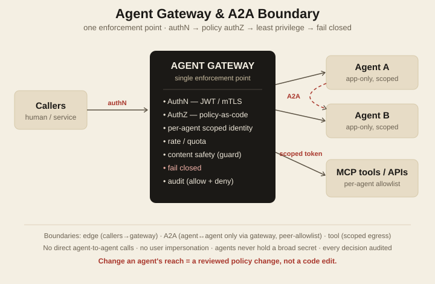

# Agent Gateway & A2A Boundary

A reference architecture for **governed, least-privilege access in multi-agent systems** — one enforcement point for authentication, policy-based authorization, agent-to-agent (A2A) mediation, and tool (MCP) egress.

Multi-agent systems fail the way distributed systems have always failed: **too much trust**. An agent with a broad token, the ability to call any peer, or permission to impersonate a user is one bug or one prompt-injection away from a bad day. This is the enforcement pattern I use to keep that blast radius near zero — the same discipline I learned running production network and datacenter security, applied to agents.

---

## Principles

1. **One enforcement point.** All agent ingress, A2A, and tool egress pass through a gateway. Nothing bypasses it.
2. **AuthN first, AuthZ second.** Identity is proven at the edge; authorization is decided narrowly, per agent.
3. **Least privilege, app-only.** Each agent has its own identity, scoped to the exact resources it needs. **No user delegation, no impersonation** — an agent never acts *as* a person.
4. **Policy-enforced, not code-enforced.** Authorization is declarative policy (policy-as-code), versioned and tested. Changing what an agent may do is a reviewed policy change, not a code edit.
5. **Fail closed.** Unknown caller, unknown tool, expired token, policy gap → deny.
6. **Observable.** Every decision — allow *and* deny — is audited with caller, target, and reason.

## Architecture (HLD) — trust boundaries

- **Edge boundary.** External callers authenticate to the gateway (OAuth2/JWT or mTLS). No agent is reachable unauthenticated.
- **A2A boundary.** Agent A cannot call Agent B directly. It calls *through* the gateway, which checks a per-agent **peer allowlist** (`A may invoke B.operationX`). No agent mesh.
- **Tool boundary.** An agent's tool/MCP calls are mediated. Each agent has a **tool allowlist** and the gateway injects a **scoped, per-backend credential** — the agent never holds a broad secret.

## Mechanics (LLD)

> Example uses Azure API Management as the gateway and Entra app registrations for identity. The pattern is portable to any gateway + IdP.

| Concern | Mechanism |
|---|---|
| **Edge authN** | `validate-jwt` (issuer / audience / expiry / signature) or client-cert (mTLS). Reject anonymous; map to a known principal. |
| **Per-agent identity** | Each agent = its own app registration, **client-credentials / app-only**. Minimal, resource-specific scopes. |
| **Scoping example** | An agent that reads one mailbox gets `Mail.Read` constrained to *that* mailbox (application access policy) — not `Mail.ReadWrite`, not delegated, no `Send`. It physically cannot reach another mailbox or impersonate a user. |
| **AuthZ** | Declarative policy decides *which agent → what (peer/tool) → which operation → which resource*. Evaluated at the gateway (policy expressions, or an external OPA-style decision point). Deny by default. |
| **A2A** | A→B requests carry A's identity; gateway checks the peer allowlist; B only ever receives pre-authorized, authenticated calls. |
| **Tool / MCP egress** | Per-agent tool allowlist; gateway holds + injects the scoped backend credential. Dangerous tools require an explicit grant (optionally a confirm step). |
| **Guardrails** | Per-agent rate limit + quota; content-safety filter (guard model) where untrusted text flows. |
| **Resilience** | Fail closed on any gap. Structured audit per call (caller, target, operation, resource, decision, correlation id). |

## Design rationale — *why* these choices

- **Why one enforcement point, not per-agent checks?** Authorization scattered across agents drifts and can't be reasoned about. A single choke point is auditable, testable, and impossible to accidentally bypass. *Trade-off:* the gateway is on the hot path — mitigated with caching and horizontal scale; the governance is worth the hop.
- **Why app-only, never impersonation?** Delegated/on-behalf-of tokens let an agent inherit a human's full reach — the worst-case blast radius. App-only with narrow scopes means a compromised agent can touch only its sliver. *Rejected:* on-behalf-of flow for "convenience."
- **Why policy-as-code, not config in the app?** Reach should change through a reviewed, versioned, testable artifact — not a code deploy. It also makes "who can do what" answerable on demand. *Rejected:* hard-coded role checks.
- **Why A2A only through the gateway?** Direct agent-to-agent calls become an unobservable mesh where lateral movement hides. Routing A2A through the gateway gives one place to authorize and log every hop. *Trade-off:* an extra hop per A2A call; worth it for the boundary.
- **Why fail closed?** A triage/automation system that fails *open* silently grants access on error. Fail-closed turns every gap into a visible denial, not an invisible grant.

## Threat model — what each control prevents

| Threat | Control |
|---|---|
| Over-scoped token → broad damage | per-agent least-privilege, resource-scoped app identity |
| Agent acts as a user / privilege escalation | app-only, **no delegation/impersonation** |
| Lateral movement between agents | A2A via gateway + peer allowlist; no direct calls |
| Prompt-injection drives an unintended tool call | tool allowlist + scoped egress + content-safety guard |
| Runaway / looping agent | per-agent rate limit + quota |
| Silent failure grants access | fail closed |
| "Who did what?" after an incident | per-call audit of allow + deny |

## When to use / not

**Use it** when multiple agents act on real systems, call each other, or invoke tools with side effects, and you need the blast radius bounded and auditable.

**Overkill** for a single read-only agent with one tool and no side effects — start simpler, add the gateway when an agent can *change* something.

---

## About

A reusable reference for the agent-access pattern I architect for enterprise multi-agent systems — generalized, with no client specifics. By **Gustavo Norymberg**, Cloud & DevOps Architect: 20+ years in infrastructure and security, now building agentic systems. More: [gustavo.rhinojedi.dev](https://gustavo.rhinojedi.dev) · [github.com/rhinolands](https://github.com/rhinolands)

## License

MIT — see [LICENSE](LICENSE).
